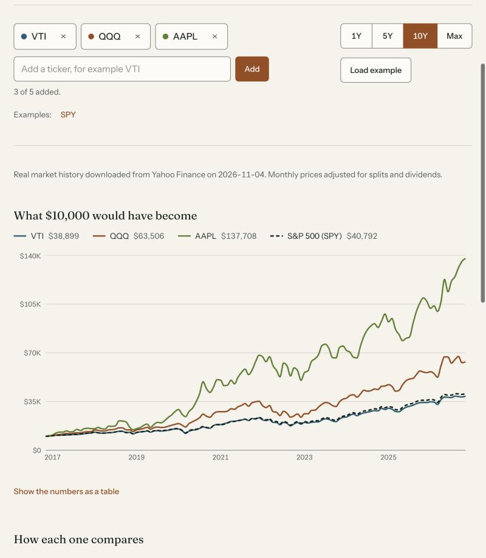
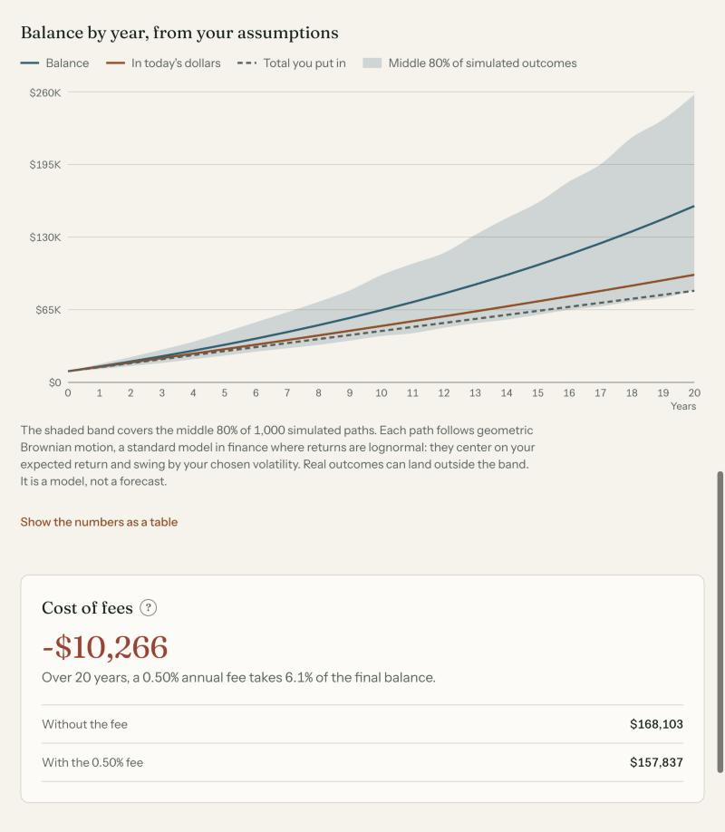

# Invest Lens

A plain-English investing analysis tool: compare how stocks and ETFs have grown, and explore how savings could grow over time.

| Compare investments | Investing simulator |
| --- | --- |
|  |  |

> **For educational purposes only. Not financial advice. Past performance does not predict future results.**

## Features

**Compare investments**
- Two to five tickers with autocomplete, plus the S&P 500 as a benchmark
- Ranges of 1Y, 5Y, 10Y and Max, all lined up on the same start date
- Line chart of the growth of $10,000
- Summary table: total return, annualized return, volatility, max drawdown, best year and worst year
- A CAPM view: beta, CAPM expected return, Jensen's alpha and R² for each ticker against the S&P 500, with a security market line chart and an adjustable risk-free rate
- Plain-English explanations next to the tables and "?" help on each term

**Investing simulator**
- Starting amount, monthly contribution, years, expected return, volatility, inflation and annual fee
- Sliders paired with number inputs, a volatility input, and Conservative, Balanced and Aggressive presets
- Chart of nominal balance, inflation-adjusted balance and total contributions
- A shaded uncertainty band: the middle 80% of 1,000 Monte Carlo paths, driven by a volatility input
- "Cost of fees" card comparing the final balance with and without the fee

**Across the app**
- Light and dark themes, responsive down to phone widths
- Skeleton loading states, empty states and specific error messages (unknown ticker, rate limit, offline)
- Keyboard navigable, labeled inputs, and a data table behind every chart for screen readers
- Settings saved in `localStorage`; no database and no login

## Tech stack

Next.js (App Router), TypeScript in strict mode, Tailwind CSS, Recharts, Vitest.

## Run locally

Requires Node.js 22.18 or newer.

```bash
npm install
npm run dev
```

Open <http://localhost:3000>. To see real market history, download it once:

```bash
npm run data:fetch
```

Without a download or an API key, the app falls back to generated sample data and labels it clearly.

```bash
npm test          # unit tests
npm run typecheck # TypeScript
npm run lint      # ESLint
npm run build     # production build
npm run data:fetch # download real monthly price history
```

## Environment variables

Copy `.env.example` to `.env.local` to use live prices.

| Variable | Required | Description |
| --- | --- | --- |
| `TWELVE_DATA_API_KEY` | No | Key from [Twelve Data](https://twelvedata.com). Read only on the server, inside `/api/prices`. Without it, the app uses sample data. |

## Data

The app picks the first source that is available and always says which one is on screen:

1. **Twelve Data (live).** Set `TWELVE_DATA_API_KEY` and prices come from the [Twelve Data](https://twelvedata.com) `time_series` endpoint as monthly closes adjusted for splits and dividends. The free Basic plan allows 8 requests per minute and 800 per day. I chose it over Alpha Vantage, whose free plan allows 25 requests per day.
2. **Downloaded real history.** `npm run data:fetch` saves monthly, dividend-adjusted closes from January 1993 to `data/history.json` for the suggested tickers. Add more with `npm run data:fetch -- KO PEP`. The file is not committed.
3. **Sample data.** If neither is set up, the app uses generated series so it still runs. They are **not real**: a seeded random walk with a shared market factor, the same on every load. A "Using sample data" notice is always shown with them.

Details:
- **Server only.** The browser calls `/api/prices`; the route handler holds any API key and reads the downloaded file.
- **Cached.** Live tickers are cached in memory for 12 hours, duplicate in-flight requests are shared, unknown tickers are remembered for an hour, and responses carry CDN cache headers.
- **Benchmark.** The S&P 500 line uses SPY as a stand-in.
- **History starts in 1993.** That is when SPY began trading. Yahoo returns coarser bars for ranges that reach further back, which would break the monthly math, so the download starts there.

**About the downloaded data.** It comes from Yahoo Finance's unofficial chart endpoint, which has no published terms for this use and can change or block requests without notice. It is meant for personal and educational use. That is why the download is a script you run yourself and the data stays out of the repository. Do not publish `data/history.json` or serve it from a public site. For a public deployment, use a Twelve Data key and read their terms first: their attribution guidance asks for visible credit where their data is shown, which the app provides, and their free plan lists "internal non-display usage".

## How the calculations work

All finance math lives in [`src/lib/finance`](src/lib/finance) as pure functions with unit tests. Prices are month-end values, so one year is 12 periods.

| Measure | Formula |
| --- | --- |
| Growth of $10,000 | `10,000 × Pₜ / P₀` |
| Total return | `P_end / P_start − 1` |
| Annualized return | `(1 + total return) ^ (1 / years) − 1`, where `years = months / 12` |
| Volatility | Sample standard deviation of monthly returns `× √12` |
| Max drawdown | `min over t of (Pₜ / highest price so far − 1)` |
| Best and worst year | December-to-December return for each full calendar year in the range |
| Beta | Slope of the asset's monthly excess returns on the benchmark's: `cov(r_asset − r_f, r_mkt − r_f) / var(r_mkt − r_f)` |
| R² | Squared correlation of those excess returns |
| CAPM expected return | `r_f + beta × (r_mkt − r_f)`, with annualized returns and the risk-free rate you set |
| Alpha (Jensen's) | Actual annualized return minus the CAPM expected return |

**Simulator.** The fee is subtracted from the expected return, `net = return − fee`, and converted to a monthly rate `m = (1 + net)^(1/12) − 1`. Each month, `balance = balance × (1 + m) + contribution`, with contributions added at month end. The inflation-adjusted value divides by `(1 + inflation)^years`. The cost of fees is the final balance with a 0% fee minus the final balance with the chosen fee.

**Uncertainty band.** Each of 1,000 paths grows month by month with a lognormal shock: `balance = balance × exp(μ + σ_m × z) + contribution`, where `z` is a standard normal draw, `σ_m = volatility / √12`, and `μ = ln(1 + m) − σ_m² / 2`. The `−σ_m² / 2` term centers the average growth on the deterministic monthly rate `m`, so a volatility of zero reproduces the plain projection exactly. The band shows the 10th and 90th percentile balance at each year end. A fixed random seed keeps it steady while you drag sliders.

These are simplified models. Real returns vary, fees and taxes differ, and nothing here predicts the future.

## Theory behind it

- **Compounding.** The simulator is the future-value formula for a growing annuity, evaluated month by month.
- **Geometric Brownian motion.** The band models an asset's value as geometric Brownian motion, so returns are lognormal and prices cannot fall below zero. This is the process behind the Black-Scholes option pricing model, and it is the standard way to represent uncertainty in continuous-time investment models, including the real-options work of Dixit and Pindyck in *Investment under Uncertainty* (Princeton University Press, 1994).
- **Volatility drag.** Because growth compounds, the typical (median) path grows slower than the average one. The `−σ² / 2` term is that effect, and it is why higher volatility lowers the median even when the average return is held fixed.
- **Capital Asset Pricing Model.** CAPM says only market risk is rewarded: an asset's expected return is the risk-free rate plus its beta times the market's excess return. The Compare tool estimates beta by regression over the months shown, plots each ticker against the security market line, and reports Jensen's alpha as the gap between actual and expected return. It is a one-factor model, it uses the benchmark's realized return in place of an expected one, and short ranges give noisy betas. The model comes from Sharpe (1964) and Lintner (1965), and alpha as a performance measure from Jensen (1968).
- **Risk and return.** Volatility and max drawdown are the risk measures shown beside return in the Compare tool, following the mean-variance idea from Markowitz's "Portfolio Selection" (1952).

Invest Lens applies these ideas at a simple level. It does not implement the real-options models in the book, and it uses no data from it.

## Project structure

```
src/
  app/                 Routes: Compare (/), Simulator (/simulator), /api/prices
  components/
    compare/           Ticker picker, chart, summary table
    simulator/         Inputs, presets, chart, fee card
    layout/            Header, footer, theme toggle
    ui/                Help tooltip, slider field, skeleton, state messages
  hooks/               usePrices
  lib/
    finance/           Returns, risk, growth and Monte Carlo math, with tests
    compare/           Lines up tickers on a shared window
    data/              Twelve Data client, downloaded-history reader, cache, sample data, tickers
scripts/               fetch-history.mts (downloads real monthly history)
```

## Data source credit

Live market data: [Twelve Data](https://twelvedata.com). Downloaded history: Yahoo Finance, for personal and educational use.

## Disclaimer

For educational purposes only. Not financial advice. Past performance does not predict future results. Invest Lens does not recommend any investment, strategy or ticker.

## Contributing

Issues and pull requests are welcome. Read [CONTRIBUTING.md](CONTRIBUTING.md) first, and note the [code of conduct](CODE_OF_CONDUCT.md) and [security policy](SECURITY.md).

## License

[MIT](LICENSE)
